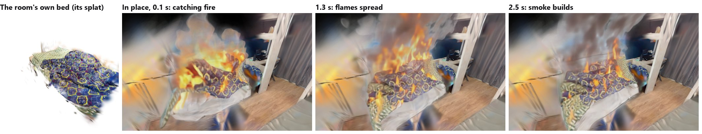

# Escape My Room

**AI emergency drills in your own room.** Film a room with a phone, and it becomes a life-size, walk-in 3D copy that a phone and a VR headset share live. Then say what happens ("the bed catches fire"), and the room's own furniture visibly burns in place: the animation is generated by AI from the room itself, not made by hand. A person on site sees the hazard over the real room on their phone, while a remote responder in a Quest headset sees the same drill at life size or from above as a dollhouse.

Built for the IEEE VR 2027 3DUI Contest. Everything runs in the browser on both devices, with the AI and heavy work on a server.

*Spike #220: room 10's bed is cut from the room's Gaussian splat, set on fire by an image-to-video model (Wan 2.2), turned into an animated 3D splat (L4GM), and put back in its place. The concept, with mock-ups: [docs/emergency-drill-concept.pdf](docs/emergency-drill-concept.pdf).*

## How it works

1. **Film the room.** On the phone's **Room photos** page, **Film with coach** records the room in the browser. It gives one prompt at a time ("Slow down", "Step back", "Show the floor") and a ring of which ways have been filmed (#100).
2. **The room is rebuilt.** On a GPU desktop, the video becomes a Gaussian-splat room in metres, with its floor levelled and a visual positioning map (#135). Optional steps: depth guidance and a needle penalty (#209), and Difix3D+ repair rounds (#215). SpatialLM finds walls, doors, windows and furniture (#206 experiments).
3. **Both devices join one live room.**
   - **The phone** shows the room at 1:1 as the person walks. 8th Wall tracking in the browser is corrected by the server's visual positioning.
   - **The Quest** uses its hands: grab, throw, scale the whole room to a dollhouse and back, a wrist menu, and voice.
   - **Physics:** one Havok simulation runs on the server (#159).
4. **A hazard from a sentence** (being built, #221). The Quest user speaks a prompt, and Qwen picks the object from the room's layout. The object is then:
   - cut from the room's own splat;
   - set on fire in a generated video (Wan 2.2);
   - lifted to a 4D splat (ImageDream + L4GM);
   - placed back where the real one stood.

   New objects ("a heater next to the sofa") start from a generated picture instead (Z-Image), with a Hunyuan3D mesh as their physics body.

## What works today

| Area | State |
|---|---|
| Room from a phone video: splat, level floor, positioning map, made live with one tap | Built (#134–#139, #209, #215) |
| Filming coach on the phone | Built (#100); device checks still open |
| Phone: 1:1 view of the room as you walk, select, carry and place objects | Built (#6, #19, #133) |
| Quest: hands, grab and throw, dollhouse scaling, wrist menu, voice call, presence | Built (#156–#163, #180–#188, #204) |
| Shared physics, objects kept inside the room | Built (#159–#163, #213) |
| Furniture generated from words or a photo, placed true to size | Built (#186, #187) |
| Room floor matched to the real floor on the Quest | In progress (#218) |
| Phone drops and throws with physics | Planned (#219) |
| **Prompted 4D hazards in the user's room** | Spike done (#220); plan and tickets #221–#235 |

## The plan: prompted 4D hazards (#221)

| Phase | Tickets |
|---|---|
| 1. Pipeline | #222 generation jobs with video and 4D steps · #223 object picture cut from the room · #224 Wan 2.2 video · #225 video quality gate · #226 L4GM on the desktop · #227 4D check and compression · #228 placement |
| 2. In the live room | #229 hazards in the shared session · #230 Quest playback · #231 phone playback |
| 3. From a sentence | #232 prompt understanding (Qwen) · #233 hazards on new objects · #234 Drill page on the wrist menu · #235 caching |

Each step checks its own result before the next runs: a level, front-facing view of the object; a fixed video prompt template; a still camera; the same object; a pure white background; a 4D result compared with its video. That is how the spike's quality is kept.

## Stack

- **Clients:** browser only. The phone page uses three.js and Spark for splats, with 8th Wall for tracking. The Quest page (`/quest/`) uses the Immersive Web SDK.
- **Server:** Python (FastAPI), with WebSocket state sync, WebRTC voice signalling and a Havok physics worker in Node.
- **GPU desktop:** Linux with an RTX 3070 Ti (8 GB). It runs the website, the reconstruction pipeline (COLMAP, gsplat), visual positioning, and L4GM, behind a Cloudflare tunnel.
- **AI models:**
  - **Qwen3-VL**, through OpenRouter: room understanding, filming checks, prompts.
  - **Z-Image-Turbo** and **Hunyuan3D-2.1**, on Hugging Face Spaces: furniture.
  - **Wan 2.2**, on a Hugging Face Space: hazard video.
  - **ImageDream and L4GM**, on the desktop: 4D.
  - **SpatialLM**: room layout.
  - **Depth Anything V2**: depth priors.
  - **Difix3D+**: optional, research licence only.

## Documents

**Running it**
- [The GPU desktop as the server](docs/gpu-server.md): setup wizard, `scripts/gpu-server/update.sh`, the tunnel.
- [Start the diagnostic](docs/diagnostic-startup.md): installation, HTTPS and WebSocket, local development.

**How the parts work**
- [Room video captures](docs/room-video.md) and the [reconstruction pipeline](docs/reconstruction.md)
- [The headset page on Immersive Web SDK](docs/quest-headset-page.md)
- [Shared physics](docs/physics.md)
- [Voice](docs/voice.md)
- [Phone view and tracking](docs/phone-tracking.md) and [landmark localisation](docs/landmark-localisation.md)
- [Connection and pose contract](docs/diagnostic-protocol.md)
- [Prepared rooms and splat rooms](docs/prepared-room.md)
- Room refinement experiments: [`experiments/room-refine/README.md`](experiments/room-refine/README.md)

**Background**
- [Emergency drill concept](docs/emergency-drill-concept.pdf), with mock-ups in room 10.
- [Related research](<Escape My Room Related Research.md>) and the [original prototype specification](<Escape My Room Prototype Spec.md>). The specification is the October scope; the escape room was the first demo scenario, before the drill.

## Tracking

The [GitHub issues](https://github.com/bhawishK/Escape-My-Room/issues) and [project board](https://github.com/users/bhawishK/projects/2) are the tracker. Start from [#221](https://github.com/bhawishK/Escape-My-Room/issues/221) for the current direction.
